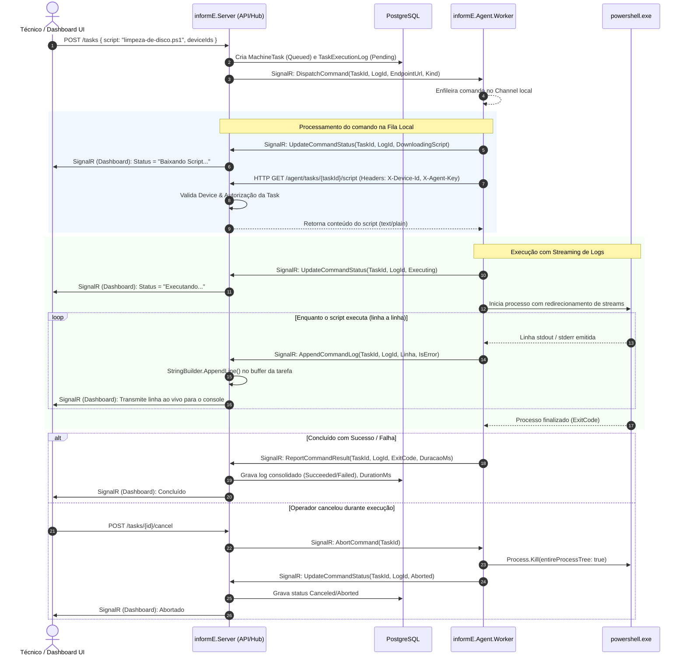

# Plano de Modernização Estrutural do Agent e Host — informE

> **Documento de Planejamento Técnico e Arquitetural (Sprint de 7 Dias)**  
> **Versão:** 1.0 — Outubro/2026  
> **Status:** Aprovado para Implementação  

---

## 1. Visão Geral e Motivação da Mudança

Atualmente, o **informE** despacha comandos remotos empacotando o código-fonte inteiro dos scripts PowerShell/Batch diretamente no payload de mensagens SignalR (`CommandDto.Script`), transmitidas via WebSocket seguro (WSS).

Embora funcional para scripts curtos de prova de conceito, essa abordagem apresenta limitações críticas para um ambiente de produção (RMM de laboratórios e PMEs):
1. **Sobrecarga de WSS:** Mensagens de texto extensas ou scripts volumosos fragmentam frames WebSocket, aumentam a latência da conexão persistente e são suscetíveis a falhas em proxies institucionais restritivos.
2. **Falta de visibilidade em tempo real:** A execução atual bloqueia o processo com `ReadToEndAsync()`, mantendo o status em "Running" por minutos sem qualquer retorno visual ao operador até o término completo.
3. **Falta de controle de concorrência no Agent:** Se múltiplos comandos forem disparados em sequência ou simultaneamente para uma mesma máquina, os processos competem por recursos e podem gerar conflitos no sistema operacional.
4. **Cancelamento unilateral:** O cancelamento no Host apenas marca a tarefa como cancelada no banco, mas o processo continua rodando solto na máquina cliente.

### A Nova Arquitetura Decidida:
* **Download de Scripts via REST API:** O SignalR envia apenas o identificador/metadados da tarefa. O Agent faz um download HTTP seguro (`GET /agent/tasks/{taskId}/script`) autenticado por headers de hardware (`X-Device-Id` e `X-Agent-Key`).
* **SignalR como Canal Puro de Orquestração e Telemetria:** O canal WSS é mantido leve, responsável apenas por:
  1. Notificação de disparo e cancelamento de tarefas (`DispatchCommand` e `AbortCommand`).
  2. Notificação granular de estados do Agent: `DownloadingScript` ➔ `Executing` ➔ `Completed` / `Failed` / `Aborted`.
  3. Streaming de logs em tempo real (emissão de chunks de texto linha a linha emitidos pelo PowerShell).
* **Buffer Centralizado no Host com `StringBuilder`:** O Host recebe os fragmentos de log em tempo real via SignalR, acumula o texto consolidado na memória/disco e propaga instantaneamente para o dashboard do técnico.
* **Fila Local de Execução no Agent:** Fila sequencial (FIFO) gerenciada via `System.Threading.Channels`, garantindo que apenas um script seja executado por vez na máquina, prevenindo sobrecarga.
* **Modo Windows Service:** Preparação estrutural para execução em segundo plano sem necessidade de sessão interativa de console ativa.

---

## 2. Diagnóstico do Estado Atual do Agent (`agente.md`)

Conforme documentado em [docs/agente.md](file:///C:/Users/Aluno/Documents/GitHub/informE/docs/agente.md) e inspecionado no código-fonte em `src/Agent/informE.Agent.Worker`:

| Componente | Estado Atual | O que precisa mudar |
|---|---|---|
| **Arquitetura** | Flat (diretório único em `informE.Agent.Worker`). | Manter estrutura flat e enxuta, porém modularizando responsabilidades (Fila de Comandos, Downloader HTTP e Runner com Streaming). |
| **Entrega de Script** | Script embutido em `CommandDto.Script` via WSS. | Removido do WSS. O Host envia DTO de despacho com rota de download e o Agent baixa via REST. |
| **Execução (`PowerShellRunner`)** | Bloqueante via `ReadToEndAsync()`. Sem streaming. Sem cancelamento ativo via token. | Leitura contínua orientada a eventos/streams (`OutputDataReceived`), emitindo logs via callback para o hub em tempo real com `CancellationToken`. |
| **Concorrência** | Inexistente. Novo comando recebido executa concorrentemente. | Implementar fila thread-safe em memória (`System.Threading.Channels.Channel<T>`). |
| **Cancelamento** | Inexistente no Agent (Host apenas descarta resultado). | Implementar handler `AbortCommand(taskId)` que cancela o token da tarefa e aborta a árvore de processos do PowerShell. |
| **Hospedagem** | Aplicação de Console (`Program.cs`). | Adicionar suporte a `AddWindowsService()` preservando execução em Console para desenvolvimento. |

---

## 3. Pré-requisitos de Conhecimento e Experiência de Código

Para executar as mudanças descritas neste plano sem introduzir regressões, deadlocks ou falhas de segurança, o desenvolvedor deve possuir nível **Pleno a Sênior em ecossistema .NET/C#**, com domínio nas seguintes áreas:

### 3.1. C# Moderno e .NET 10
* **Programação Assíncrona Avançada:** Domínio profundo de `Task`, `ValueTask`, `IAsyncEnumerable`, `CancellationTokenSource`, `TaskCompletionSource` e tratamento de `OperationCanceledException`.
* **Novas Features do C# (C# 12 e 13):** Construtores primários (`primary constructors`), records posicionais, expressões de coleção (`[..]`).

### 3.2. ASP.NET Core, Minimal APIs e Segurança
* **Minimal APIs:** Construção de rotas especializadas, injeção de dependências por parâmetro e filtros de endpoint.
* **Autenticação Customizada:** Autenticação de máquina stateless utilizando headers HTTP (`X-Device-Id` e `X-Agent-Key`) integrados ao serviço [`IAgentAuthenticator`](file:///C:/Users/Aluno/Documents/GitHub/informE/src/Host/informE.Infrastructure/Realtime/AgentHub.cs).
* **Validação de Entrada e Defesa em Profundidade:** Prevenção rigorosa de *Path Traversal* na resolução de arquivos de scripts no servidor.

### 3.3. SignalR Core (Arquitetura Realtime)
* **Hubs Fortemente Tipados (`Hub<T>`):** Definição de interfaces contratuais de cliente (`IAgentClient`, `IDashboardClient`).
* **Ciclo de Vida de Conexões:** Gerenciamento de reconexões, mapeamento de conexões ativas (`IEndpointConnectionRegistry`) e tratamento de conexões abortadas.
* **Invocação Cliente-Servidor e Push:** Transmissão de eventos de alta frequência (streaming de logs) sem estrangular a fila de pacotes TCP.

### 3.4. Concorrência e Padrões Produtor-Consumidor (`System.Threading.Channels`)
* **Uso de `Channel<T>`:** Criação de canais limitados/ilimitados (`BoundedChannelOptions` / `UnboundedChannelOptions`) para filas locais no Agent, desacoplando o recebimento de mensagens SignalR da execução síncrona do script.

### 3.5. Interoperabilidade com o Sistema Operacional Windows
* **Gerenciamento de Processos (`System.Diagnostics.Process`):**
  * Redirecionamento assíncrono de `StandardOutput` e `StandardError` sem risco de *deadlock de pipe buffer* no Windows.
  * Encerramento forçado de processos e suas árvores de filhos (`process.Kill(entireProcessTree: true)`).
* **Windows Services no .NET:** Ciclo de vida do `BackgroundService`, integração com o Service Control Manager (`sc.exe`), permissões de conta de serviço local (`LocalSystem` / administrador local).

---

## 4. Arquitetura Alvo e Fluxo de Execução



---

## 5. Plano de Implementação de 7 Dias

### Dia 1: Contratos Compartilhados, Enums e Repositório de Scripts no Host
* **Foco:** Estabelecer as interfaces e contratos no `informE.Contracts` e isolar os scripts em arquivos físicos no Host.
* **Tarefas Técnicas:**
  1. **Atualizar `informE.Contracts`:**
     - Criar `CommandExecutionState.cs`: `[Pending, Queued, DownloadingScript, Executing, Succeeded, Failed, Aborted]`.
     - Criar `CommandDispatchDto.cs`: `(Guid TaskId, Guid LogId, string ScriptUrl, string Kind)`.
     - Criar `CommandLogChunkDto.cs`: `(Guid TaskId, Guid LogId, string Line, bool IsError, DateTimeOffset Timestamp)`.
     - Atualizar `IAgentClient.cs`:
       ```csharp
       public interface IAgentClient
       {
           Task DispatchCommand(CommandDispatchDto command);
           Task AbortCommand(Guid taskId);
           Task RotateKey(string newKey);
       }
       ```
  2. **Isolar Scripts no Host:**
     - Criar pasta física `src/Host/informE.Server/scripts/` contendo os 7 scripts existentes (`limpeza-de-disco.ps1`, etc.).
     - Configurar `informE.Server.csproj` com `<None Update="scripts\**\*" CopyToOutputDirectory="Always" />`.
     - Criar interface `IScriptRepository` em `informE.Application.Interfaces` e implementação `FileSystemScriptRepository` em `informE.Infrastructure` com proteção rigorosa contra Path Traversal (`..`, `/`, `\`).
* **Critério de Conclusão do Dia:** Scripts lidos do sistema de arquivos com testes unitários cobrindo bloqueio de path traversal; contratos compilados e referenciados por Host e Agent.

---

### Dia 2: Endpoint REST Seguro de Download no Host
* **Foco:** Criar e proteger a API HTTP que entrega o conteúdo do script exclusivamente ao agente designado.
* **Tarefas Técnicas:**
  1. **Criar Endpoint Minimal API em `informE.Server/Endpoints/AgentEndpoints.cs`:**
     - Mapear `GET /agent/tasks/{taskId:guid}/script`.
  2. **Implementar Autenticação e Autorização de Máquina:**
     - Ler headers da requisição: `X-Device-Id` e `X-Agent-Key`.
     - Validar via [`IAgentAuthenticator.ValidateKeyAsync()`](file:///C:/Users/Aluno/Documents/GitHub/informE/src/Host/informE.Infrastructure/Realtime/AgentHub.cs#L43). Retornar `401 Unauthorized` se inválido.
     - Consultar a `MachineTask` no banco pelo `taskId`: verificar se o `DeviceId` autenticado faz parte da lista de alvos (`TaskExecutionLog`) daquela tarefa. Retornar `403 Forbidden` caso tente baixar script de outra máquina.
  3. **Entrega do Script:**
     - Ler o script da tarefa e retornar via `Results.Text(conteudo, "text/plain; charset=utf-8")`.
* **Critério de Conclusão do Dia:** Testes de integração confirmando que apenas o agente com credenciais válidas e vinculado à tarefa consegue baixar o script.

---

### Dia 3: Adaptação do `AgentHub` e Mecanismo de Logs com `StringBuilder`
* **Foco:** Permitir que o Host receba as atualizações de status, acumule o log em tempo real via `StringBuilder` e faça broadcast ao Dashboard.
* **Tarefas Técnicas:**
  1. **Criar Gerenciador de Buffer de Logs em Memória (`ExecutionLogBufferManager`):**
     - Usar `ConcurrentDictionary<Guid, StringBuilder>` indexado pelo `logId`.
     - Método `AppendChunk(Guid logId, string line)` que anexa ao `StringBuilder` e notifica o `IDashboardNotifier`.
     - Método `FlushAndRelease(Guid logId)` que extrai a string consolidada e limpa o buffer da memória.
  2. **Atualizar Métodos no `AgentHub`:**
     - `UpdateCommandStatus(Guid taskId, Guid logId, CommandExecutionState status)`: atualiza status no banco e notifica o dashboard.
     - `AppendCommandLog(Guid taskId, Guid logId, string line, bool isError)`: direciona para o `ExecutionLogBufferManager`.
     - `ReportCommandResult(CommandResultDto result)`: recupera o log final consolidado, salva em `TaskExecutionLog` e finaliza a tarefa.
  3. **Implementar Cancelamento Ativo (`CancelTaskUseCase`):**
     - Notificar o Agent conectado via SignalR chamando `Clients.Client(connectionId).AbortCommand(taskId)`.
* **Critério de Conclusão do Dia:** Disparo de comando através do Host aciona o SignalR e o Host é capaz de receber e acumular chunks parciais de log simulados.

---

### Dia 4: Reengenharia do Runner do Agent (`PowerShellRunner` Reativo)
* **Foco:** Transformar a execução de scripts no Agent de processo bloqueante para reativo, com suporte a cancelamento e streaming.
* **Tarefas Técnicas:**
  1. **Refatorar [`PowerShellRunner.cs`](file:///C:/Users/Aluno/Documents/GitHub/informE/src/Agent/informE.Agent.Worker/PowerShellRunner.cs):**
     - Substituir `ReadToEndAsync()` por escuta assíncrona orientada a eventos:
       - `process.OutputDataReceived += (_, e) => { if (e.Data != null) onLogLine(e.Data, false); }`
       - `process.ErrorDataReceived += (_, e) => { if (e.Data != null) onLogLine(e.Data, true); }`
     - Invocar `process.BeginOutputReadLine()` e `process.BeginErrorReadLine()`.
  2. **Suporte a Cancelamento (`CancellationToken`):**
     - Registrar callback no token recebido:
       ```csharp
       using var reg = cancellationToken.Register(() =>
       {
           try { process.Kill(entireProcessTree: true); } catch { /* ignore */ }
       });
       ```
     - Tratamento para distinguir conclusão normal de cancelamento solicitado (`Aborted`).
  3. **Preservar Defesas Existentes:**
     - Manter injeção de `$ProgressPreference = 'SilentlyContinue'` e codificação em Base64 para execução no PowerShell.
* **Critério de Conclusão do Dia:** Testes unitários do runner demonstrando streaming contínuo de linhas durante execução de script longo e interrupção imediata ao disparar cancelamento.

---

### Dia 5: Fila Local de Comandos e Cliente HTTP no Agent
* **Foco:** Implementar o download REST de scripts, a fila sequencial de tarefas e a orquestração do ciclo de vida no Worker.
* **Tarefas Técnicas:**
  1. **Criar `ScriptDownloader` no Agent:**
     - Utilizar `HttpClient` configurado sem proxy (`UseProxy = false`, ver [docs/proxy-e-build-local.md](file:///C:/Users/Aluno/Documents/GitHub/informE/docs/proxy-e-build-local.md)).
     - Injetar headers de autenticação: `X-Device-Id` e `X-Agent-Key` obtidos do `AgentIdentityStore`.
     - Implementar download com timeout e validação de resposta HTTP.
  2. **Implementar Fila de Execução Local (`CommandExecutionQueue`):**
     - Utilizar `Channel.CreateUnbounded<CommandJob>()` para enfileiramento FIFO.
     - Dicionário de controle de tarefas ativas para mapear `taskId` para `CancellationTokenSource` (permitindo cancelamento individual).
  3. **Atualizar Handlers no [`AgentWorker.cs`](file:///C:/Users/Aluno/Documents/GitHub/informE/src/Agent/informE.Agent.Worker/AgentWorker.cs):**
     - Handler `DispatchCommand`: apenas enfileira o comando no `Channel`.
     - Handler `AbortCommand(taskId)`: cancela o `CancellationTokenSource` correspondente se a tarefa estiver na fila ou executando.
     - Consumer Loop:
       - Retira item da fila.
       - Notifica status `DownloadingScript`.
       - Baixa o script via `ScriptDownloader`.
       - Notifica status `Executing`.
       - Executa no `PowerShellRunner` repassando cada linha ao hub via `AppendCommandLog`.
       - Reporta resultado final (`ReportCommandResult` ou `UpdateCommandStatus` como `Aborted`).
* **Critério de Conclusão do Dia:** Agente recebe múltiplos comandos simultâneos, enfileira, baixa cada um via HTTP e executa um por vez sem travamento.

---

### Dia 6: Suporte a Windows Service e Integração de Ponta a Ponta
* **Foco:** Habilitar suporte nativo a serviço do Windows e validar o fluxo completo entre Server, Agent e Dashboard.
* **Tarefas Técnicas:**
  1. **Habilitar Windows Service no Agent:**
     - Adicionar pacote NuGet `Microsoft.Extensions.Hosting.WindowsServices` no `informE.Agent.Worker.csproj`.
     - Adicionar `builder.Services.AddWindowsService()` no `Program.cs`.
     - Garantir que a compilação no CI (`ubuntu-latest`) continue funcionando com verificações defensivas `OperatingSystem.IsWindows()`.
  2. **Integração End-to-End:**
     - Subir Postgres + Server (`informe.ps1`).
     - Executar o Agent em máquina Windows real ou simulador.
     - Disparar tarefa via UI ou Swagger:
       - Validar transição visual: `Pending` ➔ `DownloadingScript` ➔ `Executing` ➔ `Succeeded`.
       - Verificar linhas de log aparecendo incrementalmente no console do Host.
       - Validar arquivo e banco gravados com o log completo.
  3. **Validação de Cancelamento:**
     - Disparar script longo (ex: loop de 60 segundos).
     - Acionar botão de cancelamento no Host e verificar se o processo PowerShell é encerrado e status vai para `Aborted`.
* **Critério de Conclusão do Dia:** Fluxo completo operando perfeitamente em ambiente local e serviço registrável no Windows Service Control Manager.

---

### Dia 7: Hardening, Resiliência, Documentação e Entrega
* **Foco:** Tratamento de casos extremos (edge cases), limpeza de memória e atualização da documentação técnica do repositório.
* **Tarefas Técnicas:**
  1. **Hardening de Resiliência de Rede:**
     - Tratar queda da conexão WSS durante o download REST do script (reconexão não deve duplicar tarefas nem corromper a fila).
     - Tratar expiração de memória no `ExecutionLogBufferManager` do Host (remover buffers órfãos após 1 hora se o agente sumir da rede).
  2. **Atualização da Documentação:**
     - Atualizar [docs/agente.md](file:///C:/Users/Aluno/Documents/GitHub/informE/docs/agente.md) com os novos fluxos de execução, REST e Windows Service.
     - Atualizar [docs/arquitetura-execucao.md](file:///C:/Users/Aluno/Documents/GitHub/informE/docs/arquitetura-execucao.md) marcando a arquitetura alvo como implementada.
  3. **Validação no CI:**
     - Rodar `dotnet build informE.Host.slnx` e `dotnet build informE.Agent.slnx` garantindo zero warnings com `TreatWarningsAsErrors`.
* **Critério de Conclusão do Dia:** Testes automatizados passando, documentação sincronizada e build aprovado no CI.

---

## 6. Matriz de Riscos e Mitigações Técnicas

| Risco Técnico Identificado | Impacto | Medida de Mitigação Arquitetural |
|---|---|---|
| **Vazamento de Memória no Host (Buffer de Logs)** | Alto: `StringBuilder` pode reter memória se o Agent cair antes de finalizar. | Implementar política de expiração automática (TTL de 10 min) no `ExecutionLogBufferManager` e limpeza no evento `OnDisconnectedAsync` do hub. |
| **Deadlock ao Ler Streams do PowerShell** | Crítico: Processo pode travar para sempre se o buffer de saída do Windows encher. | Utilização estrita de `BeginOutputReadLine()` e `BeginErrorReadLine()` com eventos assíncronos desacoplados, abandonando leituras síncronas. |
| **Tentativa de Acesso a Scripts Indevidos (Path Traversal)** | Alto: Agente tentar baixar arquivos fora de `scripts/`. | Sanitização estrita do nome de arquivo com `Path.GetFileName` e validação na lista de arquivos permitidos antes de qualquer I/O em disco. |
| **Download Concorrente Não Autorizado** | Médio: Um agente tentar baixar script de uma tarefa destinada a outro. | O endpoint `/agent/tasks/{taskId}/script` valida na base de dados se o `DeviceId` do header pertence aos alvos daquela tarefa. |
| **Quebra de Build no CI Ubuntu** | Médio: Falha de compilação em dependências exclusivas do Windows. | Isolar dependências Windows em blocos condicionais de compilação ou checagens `OperatingSystem.IsWindows()`. |

---

## 7. Critérios de Aceite Globais (Definition of Done)

- [ ] Nenhum script trafega como string dentro de payloads SignalR (`CommandDto.Script` eliminado).
- [ ] O download do script ocorre via chamada REST protegida por `X-Device-Id` e `X-Agent-Key`.
- [ ] O Agent transita pelos status: `DownloadingScript` ➔ `Executing` ➔ `Completed` / `Failed` / `Aborted`.
- [ ] O log da execução é transmitido em tempo real e acumulado no Host via `StringBuilder`.
- [ ] O cancelamento acionado no Host mata efetivamente o processo do PowerShell no Agent.
- [ ] Múltiplos comandos enviados para a mesma máquina entram em fila sequencial no Agent.
- [ ] O Agent suporta execução tanto como aplicação Console quanto como Windows Service.
- [ ] O projeto compila com sucesso em Linux e Windows sem alertas (`TreatWarningsAsErrors = true`).
